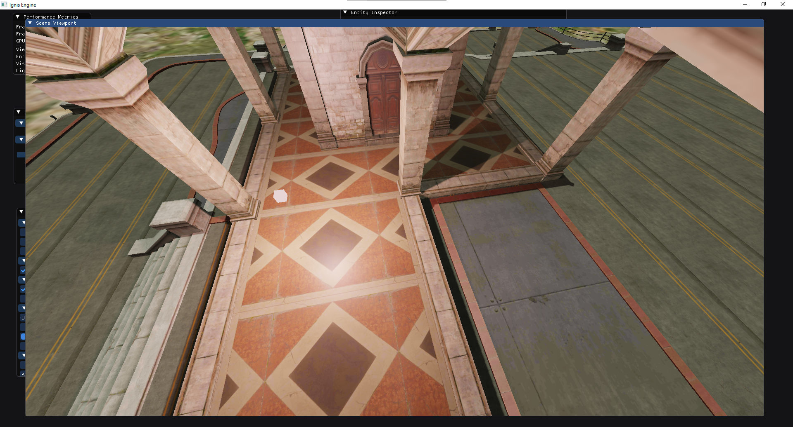
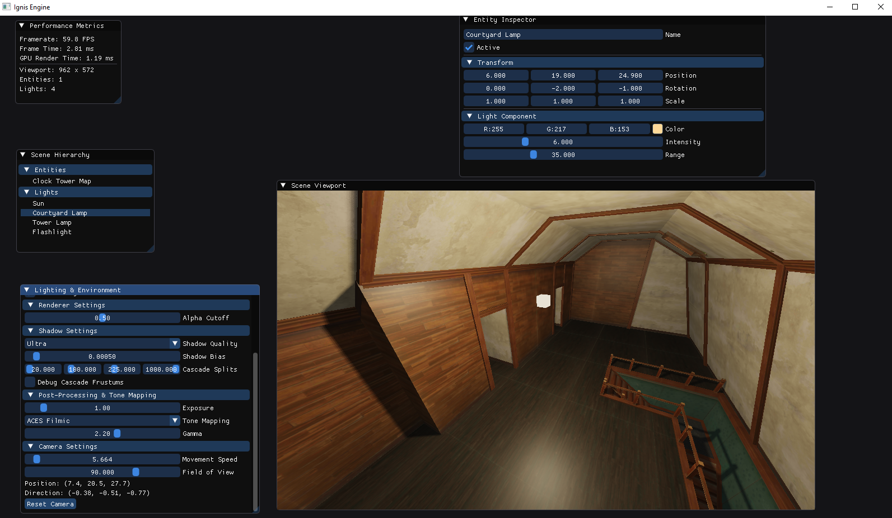
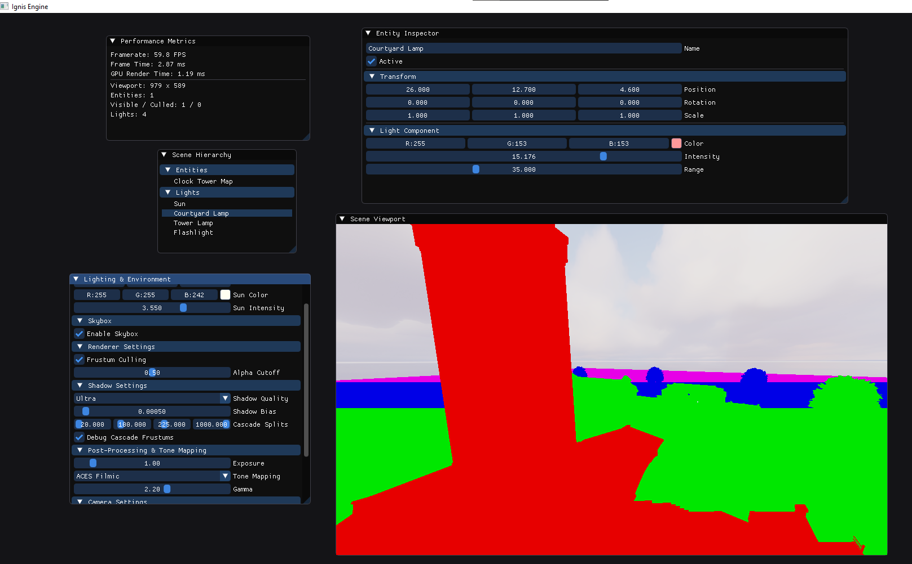
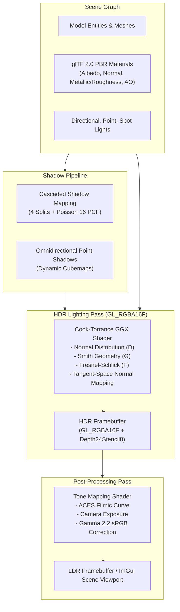

# Ignis Engine

<p align="center">
  
  
  
  
  
</p>

<p align="center">
  <strong>Ignis</strong> is a modern, high-performance 3D rendering engine built with <strong>C++23</strong>, <strong>OpenGL 4.3 Core</strong>, and <strong>Dear ImGui</strong>. It features a high-dynamic-range (HDR) color pipeline, filmic ACES tone mapping, Cook-Torrance GGX Physically Based Rendering (PBR), tangent-space normal mapping, cascaded shadow maps (CSM), and an integrated scene editor.
</p>

---

## 🎬 Showcase

<p align="center">
  
</p>
<p align="center">
  <em>Real-time Cook-Torrance PBR shading, dynamic shadows, and interactive scene editing in Ignis.</em>
</p>

<details open>
<summary><b>📸 Additional Screenshots & Demonstrations</b></summary>
<br>

<p align="center">
  
  &nbsp;
  
</p>

</details>

---

## ✨ Features

### 🌟 Physically Based Rendering (PBR) & Material Pipeline
- **Cook-Torrance Microfacet BRDF**:
  - **Normal Distribution ($D$)**: Trowbridge-Reitz GGX.
  - **Geometric Shadowing ($G$)**: Smith-Schlick GGX with direct lighting formulation.
  - **Fresnel Reflectance ($F$)**: Fresnel-Schlick with conductor/dielectric interpolation ($F_0 = \text{mix}(0.04, \text{albedo}, \text{metallic})$).
  - **Energy Conservation**: Lambertian diffuse component strictly balanced with specular reflection ($k_d = (1 - k_s)(1 - \text{metallic})$).
- **Tangent-Space Normal Mapping**: Accurate per-pixel perturbation computed via vertex TBN matrices with Gram-Schmidt orthogonalization.
- **glTF 2.0 PBR Asset Pipeline**: Full material ingestion for:
  - Base Color / Albedo (`aiTextureType_BASE_COLOR` / `aiTextureType_DIFFUSE`)
  - Metallic-Roughness (glTF packed channel standard: Green = Roughness, Blue = Metallic)
  - Tangent Normal maps
  - Ambient Occlusion (AO)
  - Dynamic scalar factors (`baseColorFactor`, `metallicFactor`, `roughnessFactor`)
- **Smart Fallback Texture Architecture**: Automated 1x1 default textures (White albedo, flat normal, standard metallic-roughness, white AO) guaranteeing valid texture units across all draw passes.

### 🌈 HDR Floating-Point Pipeline, Bloom & Filmic Tone Mapping
- **16-bit Float Framebuffer (`GL_RGBA16F`)**: Preserves radiant light intensities $> 1.0$ without clamping or banding.
- **Multi-Scale Dual-Filter HDR Bloom**:
  - Progressive 5-mip downsample chain with 13-tap Karis box filter and partial-karis firefly suppression.
  - Smooth knee brightness thresholding to avoid harsh step artifacts.
  - Progressive 9-tap tent filter upsampling with additive blending.
  - Composite pass with configurable bloom intensity, radius, and threshold.
- **ACES Filmic Tone Mapping**:
  - Standard academy filmic color curve with natural highlight roll-off and deep contrast.
  - Reinhard Operator & raw clamp fallback modes.
  - Real-time camera exposure slider ($0.01\times$ to $10.0\times$) and gamma correction ($2.2$).

### 🌫️ Atmospheric Fog & Horizon Blending
- **Distance & Height-Fog**: Exponential squared distance attenuation blended with linear range falloff.
- **Altitude / Height Gradient**: Fog naturally settles thicker in low-lying terrain and valleys.
- **Directional Sun In-Scattering**: Atmospheric halo and warm glow when looking towards the sun.
- **Seamless Skybox Horizon Blending**: Panoramic skydome and cubemap horizon automatically blend into fog color to eliminate abrupt background clipping.

### 🌑 Dynamic Shadow Mapping Subsystem
- **Cascaded Shadow Mapping (CSM)**:
  - 4 directional light cascade splits fitted dynamically to the camera view frustum.
  - **Poisson 16-sample PCF**: Stochastic disk multisampling for soft, artifact-free penumbra.
  - Configurable shadow bias and cascade split lambda.
  - **Frustum Debug Mode**: Color-coded visualization of cascade levels in real time.
- **Omnidirectional Point Light Shadows**:
  - Dynamic cubemap depth rendering (`GL_TEXTURE_CUBE_MAP`).
  - **20-Sample Spherical Poisson PCF**: Smooth, jitter-free shadow borders.
  - **Karis Windowed Attenuation**: Unreal-style smooth quadratic cutoff $(1 - (d/R)^2)^2$ eliminating hard light circular borders.
- **Spotlights**: Realistic dual-cone angle cutoffs and smooth penumbra falloff.

### ⚡ Performance & Culling
- **Camera Frustum Culling**:
  - Gribb-Hartmann view-projection matrix extraction of 6 frustum planes.
  - World-space transformed 8-corner AABB bounding box visibility test against positive half-spaces.
  - Real-time performance telemetry reporting rendered vs culled entity counts.

### 🛠️ Integrated Scene Editor & Workflow (Dear ImGui & ImGuizmo)
- **Interactive 3D Viewport Transform Gizmos**:
  - 3D translation arrows, rotation rings, and scale cubes directly inside the viewport.
  - Quick hotkeys: `W` (Translate), `E` (Rotate), `R` (Scale), `Q` (Hide).
  - Local vs World coordinate space modes.
  - Grid and angle snapping support.
- **Scene Serialization & JSON Persistence**:
  - Main menu bar with `File` (`New Scene`, `Open Scene...`, `Save Scene`, `Save Scene As...`).
  - Keyboard shortcuts (`Ctrl+S`, `Ctrl+O`, `Ctrl+N`).
  - Saves entities, models, transforms, lights, skybox, bloom, fog, and exposure into human-readable `.scene` JSON files.
- **Scene Hierarchy & Entity Inspector**:
  - Tree view with entity selection, addition (`Directional Light`, `Point Light`, `Spotlight`), and deletion.
  - Full inspector controls for materials, light properties, and transforms.
- **Performance Telemetry**: Live FPS, CPU frame time (ms), GPU render time (ms), and culling statistics.
- **Fly Camera**: Smooth 6-DoF editor navigation with configurable movement speed and field-of-view (FoV).

---

## 🏗️ Architecture



---

## 🚀 Getting Started

### Prerequisites
- **Operating System**: Windows 10/11 (x64)
- **Compiler**: Visual Studio 2022 / 2026 (MSVC with **C++23** support: `/std:c++23preview` or `/std:c++23`)
- **CMake**: Version 3.20 or newer (optional, if building with CMake)
- **Graphics Hardware**: GPU supporting **OpenGL 4.3 Core** or higher

### 🔨 Building the Engine

#### Method 1: Visual Studio Solution (Recommended)
1. Clone the repository:
   ```bash
   git clone https://github.com/your-username/ignis-engine.git
   cd ignis-engine
   ```
2. Open `Ignis.sln` in Visual Studio.
3. Select **Release** and **x64** in the configuration toolbar.
4. Press `Ctrl + Shift + B` (or `Build -> Build Solution`).
5. Run with `F5` (or execute `x64/Release/Ignis.exe`).

#### Method 2: CMake with Presets
Ignis provides pre-configured CMake presets for rapid building:

```bash
# Configure using the release preset
cmake --preset x64-release

# Build the project
cmake --build --preset x64-release
```
The compiled executable will be located in `build/Release/Ignis.exe`.

---

## 🎮 Editor Controls

| Input | Action |
| :--- | :--- |
| **Right Click + Drag** | Look around (Fly camera) |
| **W / A / S / D** | Move camera forward / left / backward / right |
| **Q / E** | Move camera down / up |
| **Mouse Scroll** | Adjust Field of View (Zoom) |
| **Left Click (Hierarchy)** | Select entity to view in Inspector |
| **Left Click (Viewport)** | Focus viewport panel |

---

## 📁 Project Structure

```
ignis-engine/
├── docs/                # Project documentation and showcase media (showcase.gif)
├── res/                 # Scene assets, 3D models (glTF/GLB/FBX), textures, skybox
├── shaders/             # GLSL shader programs
│   ├── Main.shader      # Cook-Torrance GGX PBR + Normal Mapping + CSM & Point Shadows
│   ├── ToneMap.shader   # Fullscreen ACES Filmic tone mapping & exposure pass
│   ├── Light.shader     # Point light visualizer cubes
│   └── ...              # Shadow depth mapping shaders
├── src/
│   ├── core/            # Engine runtime lifecycle, window management, input handler
│   ├── editor/          # Dear ImGui scene hierarchy, inspector, environment controls
│   ├── renderer/        # Framebuffer, Mesh, Model, Primitive, Shader, Renderer, Shadows
│   └── scene/           # Entity graph, Lights, Skybox, Scene abstraction
├── vendor/              # Third-party libraries (Assimp, ImGui, GLM, GLEW, GLFW, STB)
├── CMakeLists.txt       # CMake build configuration
├── CMakePresets.json    # Standardized CMake build presets
└── Ignis.sln            # Visual Studio solution file
```

---

## 🗺️ Roadmap
- [x] Modern C++23 standardization & clean architecture
- [x] HDR Floating-Point pipeline (`GL_RGBA16F`)
- [x] ACES Filmic tone mapping & exposure controls
- [x] Cook-Torrance GGX PBR multi-light forward shading
- [x] Tangent-space normal mapping & glTF 2.0 PBR material parsing
- [x] Cascaded Shadow Mapping (CSM) with Poisson 16 PCF
- [ ] **Image-Based Lighting (IBL)**: Diffuse Irradiance Convolution & Pre-filtered Environment Specular Reflections
- [ ] **Cinematic Post-Processing**: Physically-Based Bloom pyramid & Screen-Space Ambient Occlusion (SSAO)
- [ ] **Performance Culling**: CPU View Frustum Culling via AABB/OBB
- [ ] **Editor Enhancements**: Interactive 3D Transform Gizmos (ImGuizmo) & Runtime Material Editor

---

## 📜 License & Credits

This project is licensed under the [MIT License](LICENSE).

### Third-Party Libraries
- [GLFW](https://www.glfw.org/) - Windowing and input handling
- [GLEW](https://glew.sourceforge.net/) - OpenGL Extension Wrangler
- [GLM](https://github.com/g-truc/glm) - OpenGL Mathematics
- [Dear ImGui](https://github.com/ocornut/imgui) - Immediate mode graphical user interface
- [Assimp](https://github.com/assimp/assimp) - Open Asset Import Library
- [stb_image](https://github.com/nothings/stb) - Image loading library